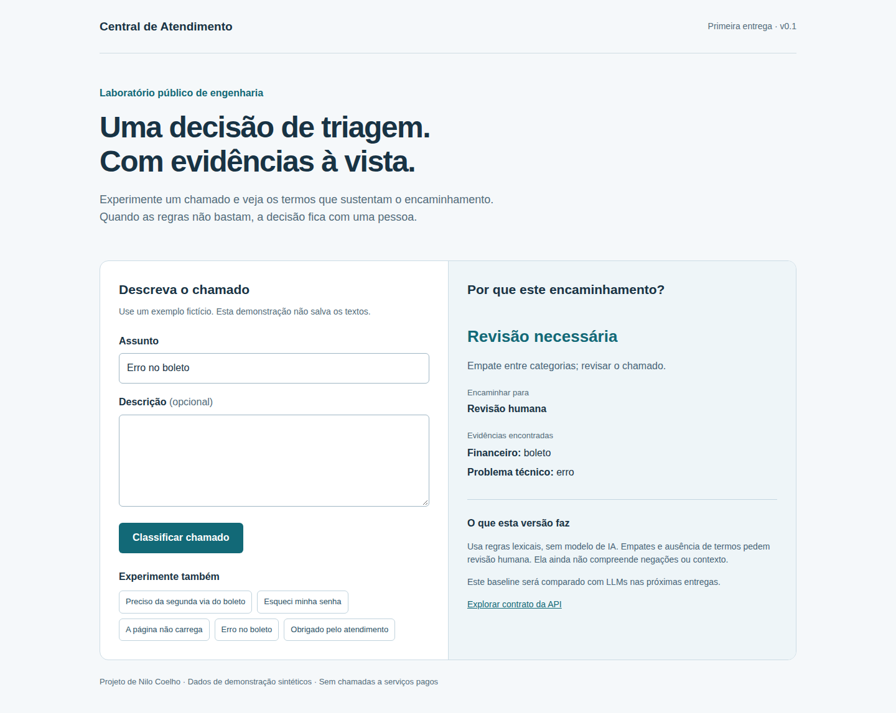

# Central de Atendimento com IA

Projeto público de Nilo Coelho para investigar decisões de engenharia em uma central de atendimento: classificação, recuperação de informação e ações controladas.

**Estado atual: v0.1 - baseline de triagem por regras, API Python e interface React. Nenhum LLM está integrado nesta versão.**



## Experimente localmente

Requisitos: Python 3.12+ e Node.js 22.19+ (ambiente local verificado: Python 3.14.4 e Node.js 22.19).

```bash
python3 -m venv .venv
.venv/bin/pip install -r requirements.lock
npm --prefix frontend ci
npm --prefix frontend run build
.venv/bin/uvicorn app.main:app --host 127.0.0.1 --port 8431
```

Abra http://127.0.0.1:8431 e o contrato interativo em http://127.0.0.1:8431/docs. O processo é manual; Ctrl+C encerra o serviço. Confira a disponibilidade da porta antes de iniciar.

Para desenvolvimento, execute a API como acima e, em outro terminal, `npm --prefix frontend run dev`. O Vite usa a porta 4318 e encaminha `/api` para a API local.

## Problema e comportamento

Um chamado contém assunto e descrição. O baseline conta termos distintos por categoria: financeiro, acesso, problema técnico e melhoria. Ausência de evidência ou empate encaminham para revisão humana. A resposta expõe os termos que determinaram o resultado.

```bash
curl http://127.0.0.1:8431/api/triage \
  -H 'Content-Type: application/json' \
  -d '{"subject":"Preciso da segunda via do boleto"}'
```

Os textos enviados não são persistidos. Use somente dados fictícios. Não há contas, autenticação, edição de chamados ou autorização multiusuário nesta versão; o servidor é uma demonstração local, não um serviço pronto para exposição pública.

## Resultado inicial e limites

| Conjunto sintético | Casos | Acurácia |
| --- | ---: | ---: |
| Desenvolvimento | 24 | 100% |
| Holdout público | 16 | 75% |

Os quatro erros do holdout incluem ausência de palavras-chave, negação e contexto misto. **Esses números não estimam desempenho com clientes reais.** Os exemplos foram escritos manualmente com assistência de agentes; o holdout não é independente nem cego. Não foi ajustada uma regra após observar os erros desta primeira avaliação. Mudanças futuras exigirão novos casos reservados para uma comparação honesta.

Relatórios completos: [desenvolvimento](reports/baseline-dev.json) e [holdout](reports/baseline-holdout.json). Incluem suporte, precisão, recall e F1 por classe, resultados por exemplo e hashes dos dados e regras. Latência é medida dentro do processo, sem HTTP/interface; não é benchmark de produção.

```bash
.venv/bin/python -m pytest -q
.venv/bin/python -m scripts.evaluate --split dev
.venv/bin/python -m scripts.evaluate --split holdout
```

## Decisões e próximos incrementos

- Começar por um baseline barato e inspecionável permite avaliar se um LLM acrescenta valor.
- Contar termos distintos evita que repetição infle o resultado; esse resultado não é probabilidade nem confiança calibrada.
- Separar desenvolvimento e holdout explicita a diferença entre exemplos usados no desenho e na avaliação.
- A próxima entrega compara este contrato com um modelo local e amplia a avaliação humana.
- Rails/PostgreSQL entrarão com o domínio persistido de chamados e permissões; não há scaffolding sem uso nesta versão.

[Arquitetura e evolução](docs/architecture.md) · [Dados e rotulagem](data/README.md) · [Próxima entrega](docs/next-delivery.md)

## English summary

Public engineering portfolio project exploring support-ticket triage, grounded retrieval and controlled actions. Version 0.1 ships an explainable lexical baseline, a FastAPI contract, a React/TypeScript interface and reproducible synthetic evaluations. It does not call an LLM or claim production readiness. The public synthetic holdout scores 12/16; error analysis is part of the result, not omitted from the presentation.

Development is assisted by AI coding agents. Human review and acceptance remain separate from automated validation. Project ownership does not imply that every line was written manually.

## License

Code and original synthetic examples are available under the [MIT License](LICENSE). No employer code, customer data or private documents are included.
